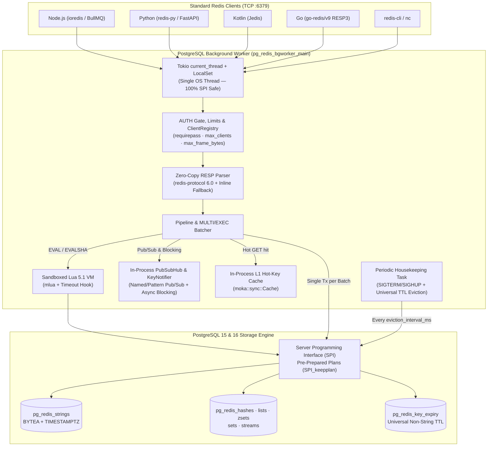
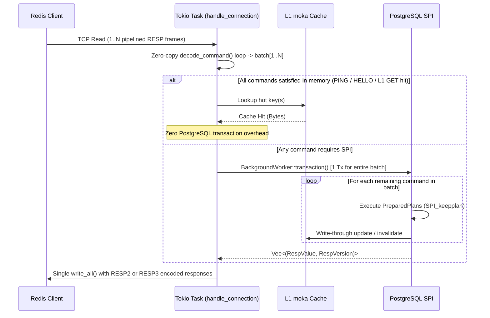

# System Architecture

`pg_redis_core` embeds an asynchronous Redis-compatible TCP server inside a dedicated PostgreSQL background worker process, eliminating extra network hops and dual-database synchronization hazards.

## High-Level Data Flow

## Thread-Safety Model: `current_thread` Tokio + `LocalSet`

PostgreSQL backend processes maintain process-global C state (`CurrentMemoryContext`, `TopTransactionContext`, `SPI_tuptable`, `sigjmp_buf`) that is **strictly single-threaded**. Calling SPI from a multi-threaded Tokio worker pool would corrupt PostgreSQL backend memory.

`pg_redis_core` guarantees safety while preserving high socket concurrency:

1. **Single OS Thread:** The background worker builds `tokio::runtime::Builder::new_current_thread().enable_all()` and drives all tasks inside a `tokio::task::LocalSet`.
2. **Multiplexed Async I/O:** Hundreds of concurrent TCP sockets are multiplexed non-blockingly via `epoll`/`kqueue` with `TCP_NODELAY` enabled to eliminate Nagle latency.
3. **Atomic Synchronous SPI Blocks:** No `.await` point ever occurs inside a `BackgroundWorker::transaction(|| Spi::connect(...))` closure, so SPI transactions execute atomically and sequentially with zero interleaving.

## Request Lifecycle & Pipelining

## Protocol Negotiation (RESP2 & RESP3)

Each TCP connection tracks its own `ConnectionState`:

- Defaults to **RESP2** (full compatibility with `nc`, `redis-cli`, `redis-py`, `Jedis`).
- Upgrades dynamically to **RESP3** when a client sends `HELLO 3` (used by default by `go-redis/v9`).
- Encodes `Map` responses (`HGETALL`, `HELLO`) as flat arrays in RESP2 and `%N\r\n` maps in RESP3; encodes `ScoredArray` (`ZRANGE ... WITHSCORES`) as flat bulk strings in RESP2 and nested `[member, Double]` tuples in RESP3.
- Supports inline text commands (`PING\r\n`, `SET foo "bar baz"\r\n`) alongside multibulk arrays (`*N\r\n...`).

## Embedded Lua 5.1 Scripting (`mlua`) & Why Not `pllua-ng`

While PostgreSQL has a standalone procedural language extension (**`pllua` / `pllua-ng`**) for writing SQL stored procedures and triggers in Lua 5.3/5.4, Redis scripting (and job frameworks like **BullMQ 5.13.0**) requires:

- **Exact Lua 5.1 semantics** (`unpack()`, `bit` library, Lua 5.1 coercion rules),
- **Redis-specific libraries and globals**: binary-safe `KEYS` / `ARGV`, `redis.call` / `redis.pcall`, `cjson`, `cmsgpack` (used by BullMQ for job arguments and options), and exact Lua↔RESP type conversions (`nil` bulk reply → `false`, `{ok=...}`, `{err=...}`),
- **Zero-hop transactional execution** inside the active PostgreSQL SPI transaction.

`pg_redis_core` therefore embeds **Lua 5.1 directly inside the Rust background worker** via `mlua` (`features = ["lua51", "vendored"]`), caching compiled chunks by 40-char SHA1 (`SCRIPT LOAD` / `EVALSHA`) and executing `redis.call(...)` directly against the active PostgreSQL SPI transaction with full ACID atomicity.

To keep user scripts safe inside the PostgreSQL server process:

- **Restricted Stdlib Sandbox:** Only `StdLib::TABLE | StdLib::STRING | StdLib::MATH` are loaded; dangerous globals (`os`, `io`, `package`, `debug`, `dofile`, `loadfile`, `collectgarbage`, `module`, `require`) are absent/stripped.
- **Execution Timeout Hook:** A Lua instruction hook checks elapsed time against `pg_redis.lua_time_limit_ms` (default `5000` ms) and aborts infinite loops before they can stall the worker.

## In-Process Pub/Sub (`PubSubHub`)

Named-channel (`SUBSCRIBE`/`UNSUBSCRIBE`) and glob-pattern (`PSUBSCRIBE`/`PUNSUBSCRIBE`) Pub/Sub run entirely inside the background worker's `LocalSet` (`src/pubsub.rs`):

- **Zero SPI Overhead & Arbitrary Payload Sizes:** Messages flow directly in memory over bounded per-subscriber Tokio channels (`pg_redis.pubsub_queue_size`, default `4096`), bypassing PostgreSQL's 8 KB `NOTIFY` payload limit and preserving full binary safety.
- **Slow-Consumer Eviction & RAII Cleanup:** Subscribers that fall behind their queue capacity are evicted without blocking publishers or healthy consumers. Dropping a TCP connection triggers `PubSubClientGuard` cleanup automatically.
- **Exact Wire Semantics:** Emits `["subscribe"|"unsubscribe"|"psubscribe"|"punsubscribe"|"message"|"pmessage", ...]` frames (as RESP3 Push `>` frames on RESP3 connections), enforces RESP2 subscribed-mode command rules, and supports `PUBLISH` from both Lua scripts (`redis.call('PUBLISH', ...)`) and `MULTI`/`EXEC` transactions.

## Authentication, Resource Limits & Multi-Client Registry (`ClientRegistry`)

- **Authentication & Limits (`src/config.rs`, `src/worker.rs`):** When `pg_redis.requirepass` is set, connections must pass constant-time `AUTH` or `HELLO ... AUTH` before executing commands. Incoming connections are capped by `pg_redis.max_clients`, and buffered RESP requests are bounded by `pg_redis.max_frame_bytes`.
- **Live Client Tracking (`src/clients.rs`):** Every TCP connection registers with `ClientRegistry`, tracking ID, peer address, client name (`CLIENT SETNAME`), protocol version, and active Pub/Sub subscriptions. This powers `CLIENT LIST [TYPE ...] [ID ...]`, `CLIENT INFO`, `CLIENT KILL [ID|ADDR]`, and `INFO` `# Clients` (`connected_clients`, `maxclients`) — required by BullMQ `queue.getWorkers()` and `queue.getQueueEvents()`.

## Cooperative Blocking Wakeups (`BZPOPMIN`, `BLPOP`, `XREAD BLOCK`)

Blocking commands are handled asynchronously on the background worker's `LocalSet` via `KeyNotifier` (`tokio::sync::Notify` per watched key):

- Idle workers (such as BullMQ workers blocked on `BZPOPMIN bull:<queue>:marker <timeout>` or `QueueEvents` blocked on `XREAD BLOCK ... STREAMS ...`) yield without holding a PostgreSQL transaction or burning CPU.
- Whenever any command — direct or inside a Lua script (`ZADD`, `LPUSH`, `RPUSH`, `XADD`) — commits a mutation, `KeyNotifier` wakes waiting tasks **immediately after PostgreSQL transaction commit**, guaranteeing MVCC visibility and sub-millisecond wakeup latency.

## Signal Handling & Clean Shutdown

During PostgreSQL startup/shutdown (including Docker's temporary `initdb` server cycle), the background worker monitors `BackgroundWorker::sigterm_received()` and `wait_latch` return status via an atomic `SHUTDOWN_REQUESTED` latch. On `SIGTERM`, a `tokio::sync::watch` channel terminates the accept loop and active client handlers within 50ms, dropping `TcpListener` immediately so `pg_ctl stop` completes cleanly.
