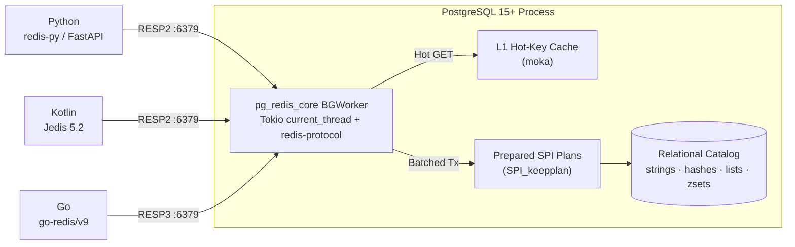

---
hide:
  - navigation
  - toc
---

<div class="hero-banner" markdown>

<div class="hero-badges">
  <span class="hero-badge">PostgreSQL 15 &amp; 16</span>
  <span class="hero-badge">Rust + pgrx 0.11</span>
  <span class="hero-badge">RESP2 &amp; RESP3</span>
  <span class="hero-badge">Pub/Sub (ioredis 5.11)</span>
  <span class="hero-badge">Lua 5.1 (EVAL/EVALSHA)</span>
  <span class="hero-badge">BullMQ 5.13 Ready</span>
</div>

# pg_redis_core

Speak native **Redis (RESP2 &amp; RESP3)** on port `6379` directly inside **PostgreSQL**. Keep your existing `redis-py`, `Jedis`, and `go-redis/v9` drivers while unifying cache and relational persistence inside a single ACID-compliant database.

<div class="hero-actions" markdown>
[Get Started in 60s](getting-started/quickstart.md){ .md-button .md-button--primary }
[Client Examples](examples/clients.md){ .md-button }
[Architecture](architecture/overview.md){ .md-button }
</div>

</div>

<div class="metric-grid">
  <div class="metric-card">
    <div class="metric-value">504K req/s</div>
    <div class="metric-label">Hot-key L1-cached <code>GET</code> (<code>p50 = 0.27ms</code>)</div>
  </div>
  <div class="metric-card">
    <div class="metric-value">8.5K req/s</div>
    <div class="metric-label">Pipelined <code>SET</code> throughput (<code>UNLOGGED</code>)</div>
  </div>
  <div class="metric-card">
    <div class="metric-value">RESP2 &amp; 3</div>
    <div class="metric-label">Zero-copy <code>redis-protocol 6.0</code> parser</div>
  </div>
  <div class="metric-card">
    <div class="metric-value">1 Database</div>
    <div class="metric-label">Zero cache-invalidation drift or dual ops</div>
  </div>
</div>

## Why `pg_redis_core`?

<div class="grid cards" markdown>

-   :material-memory:{ .lg .middle } **Break Free from RAM-Bound Costs**

    ---

    Store gigabytes of sessions, queues, leaderboards, and cached payloads on SSD/NVMe-backed PostgreSQL tables instead of expensive memory-only clusters.

-   :material-database-sync:{ .lg .middle } **Single ACID Source of Truth**

    ---

    Query, join, audit, and back up your Redis keys directly using standard PostgreSQL SQL (`pg_redis_strings`, `pg_redis_hashes`, `pg_redis_lists`, `pg_redis_zsets`).

-   :material-flash:{ .lg .middle } **Engineered for Speed**

    ---

    Combines an in-process `moka` L1 hot-key cache, `SPI_keepplan` prepared statements, pipelined transaction batching, `fillfactor = 80` HOT updates, and optional `UNLOGGED` WAL bypass.

-   :material-language-python:{ .lg .middle } **Drop-In Driver & BullMQ Compatibility**

    ---

    Verified against unmodified **BullMQ 5.13.0** (Medusa queues: Lua 5.1 + `cmsgpack` + `cjson` + `XADD` + `BZPOPMIN`), `redis-py` / `FastAPI`, `Jedis` (Kotlin), `go-redis/v9` (RESP3), and `redis-cli`.

</div>

## 30-Second Preview

```bash
git clone https://github.com/MegacoderKim/pg2redis.git
cd pg2redis

# Boot PostgreSQL 15 with pg_redis_core listening on :5432 and :6379
docker compose up -d --build --wait pg-redis

# Write via Redis protocol
docker compose exec pg-redis redis-cli SET greeting "hello from postgres"

# Read directly from PostgreSQL SQL
docker compose exec pg-redis psql -U postgres -c \
  "SELECT key, convert_from(value, 'UTF8') AS value FROM pg_redis_strings;"
```


